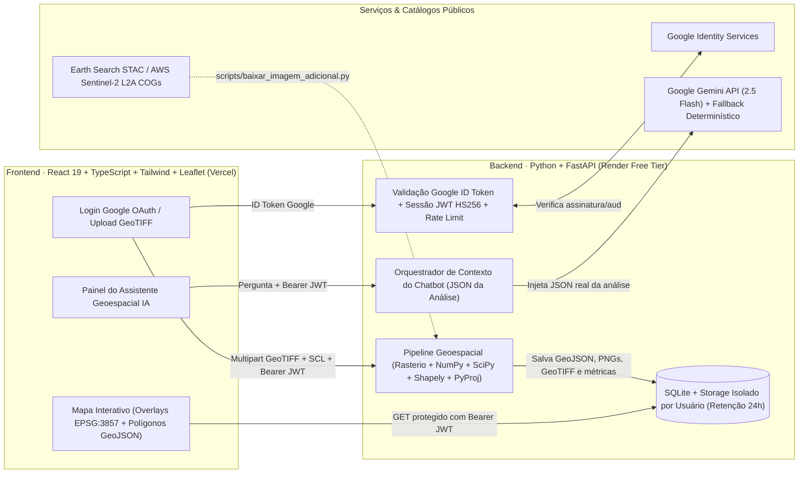

# Global Watch · Assistente Geoespacial para Café

> 🌐 **Aplicação em Produção (Frontend Vercel):** [https://globalwatch-cafe.vercel.app](https://globalwatch-cafe.vercel.app)  
> ⚙️ **API Backend em Produção (Google Cloud Run):** [https://globalwatch-backend-284416777232.us-central1.run.app](https://globalwatch-backend-284416777232.us-central1.run.app) (Swagger: [/api/docs](https://globalwatch-backend-284416777232.us-central1.run.app/api/docs))  
> ⚙️ **API Backend Espelho (Render):** [https://globalwatch-lptl.onrender.com](https://globalwatch-lptl.onrender.com)  
> 📦 **Repositório GitHub:** [https://github.com/IgorSouza-ui/globalwatch](https://github.com/IgorSouza-ui/globalwatch)

Aplicação web fullstack (**React + TypeScript + Leaflet** no frontend e **Python + FastAPI + Rasterio + NumPy + Shapely** no backend) para autenticação com Google, upload e processamento real de imagens multiespectrais **Sentinel-2 L2A (GeoTIFF)**, identificação e vetorização de **áreas potenciais de cultivo de café**, visualização em mapa interativo de satélite e consulta a um **Assistente IA (Gemini)** contextualizado com os dados e geometrias calculados.

> **Nota importante:** Índice de vegetação e bandas ópticas isoladas não comprovam a presença de café. O sistema diferencia explicitamente **áreas potenciais (candidatas)** de uma classificação validada em campo e não apresenta métricas de acurácia sem evidência de campo. Consulte a [**Nota de Pesquisa e Relato de Uso de IA (`docs/NOTA_PESQUISA.md`)**](docs/NOTA_PESQUISA.md).

---

## 1. Arquitetura do Sistema



### Estrutura do Repositório

```text
├── backend/
│   ├── app/
│   │   ├── main.py          # Endpoints FastAPI, CORS, Rate Limiting, validação de upload e isolamento
│   │   ├── auth.py          # Verificação de ID Token Google OAuth2 + emissão/revogação de JWT próprio
│   │   ├── processing.py    # Pipeline Rasterio/NumPy/SciPy/Shapely/PyProj (radiometria, SCL, índices, polígonos)
│   │   ├── chat.py          # Chatbot IA (Google Gemini Flash + fallback determinístico ancorado nos dados)
│   │   ├── storage.py       # Persistência SQLite, controle de cotas diárias e expurgo automático (retenção)
│   │   └── config.py        # Configurações via variáveis de ambiente (sem segredos no código)
│   ├── samples/             # Recorte oficial do kit + 2 cenas reais adicionais (Guaxupé 2024 e Três Pontas 2025)
│   ├── tests/
│   │   └── test_app.py      # 13 testes automatizados de geoprocessamento e segurança (pytest)
│   ├── requirements.txt
│   └── .env.example
├── frontend/
│   ├── src/
│   │   ├── App.tsx          # Interface responsiva (Desktop 3 colunas / Mobile em abas)
│   │   ├── api.ts           # Cliente HTTP tipado com envio de Bearer token e download autenticado
│   │   └── components/
│   │       ├── MapView.tsx  # Mapa Leaflet (RGB, NDVI, 6 Classes, polígonos interativos e legenda)
│   │       └── ChatPanel.tsx# Interface do chatbot com sugestões rápidas e renderização Markdown
│   └── .env.example
├── scripts/
│   ├── baixar_imagem_adicional.py # Busca e recorta cenas reais Sentinel-2 L2A via STAC Earth Search
│   └── verificar_mapbiomas.py     # Verificação cruzada independente com a Coleção 9 do MapBiomas (classe 46)
├── docs/
│   └── NOTA_PESQUISA.md     # Nota de pesquisa (2 páginas) e relato detalhado do uso de IA
└── render.yaml              # Blueprint de deploy gratuito no Render
```

---

## 2. Método de Geoprocessamento e Classificação

O pipeline em [`backend/app/processing.py`](backend/app/processing.py) processa qualquer GeoTIFF multiespectral georreferenciado de 4 bandas (`B02 azul`, `B03 verde`, `B04 vermelho`, `B08 infravermelho próximo`) executando 7 etapas reais:

1. **Validação e leitura do raster:** Verifica assinatura binária TIFF (*magic bytes*), CRS, transformada afim, número de bandas e limite de dimensões.
2. **Conversão radiométrica única (`DN → Reflectância`):**
   - Lê `scale` e `offset` do próprio GeoTIFF (`Reflectância = DN × 0,0001 − 0,1`), aplicando a conversão **uma única vez** e mascarando `DN = 0` como `NoData`.
3. **Máscara de qualidade (`SCL`):**
   - Quando a camada *Scene Classification Layer* (`qualidade_scl.tif`, 20 m) é enviada, ela é reamostrada por vizinho mais próximo (*nearest neighbor*, preservando valores categóricos) para a grade de 10 m. Pixels nas classes `0, 1, 2, 3, 8, 9, 10, 11` (sem dado, saturado, sombra escura/topográfica, sombra de nuvem, nuvem média/alta, cirrus e neve) são excluídos; `SCL = 6` é marcado como água.
4. **Cálculo de 4 índices espectrais:**
   - `NDVI = (NIR − Red) / (NIR + Red)`
   - `SAVI = 1,5 × (NIR − Red) / (NIR + Red + 0,5)`
   - `GNDVI = (NIR − Green) / (NIR + Green)`
   - `NDWI (McFeeters) = (Green − NIR) / (Green + NIR)`
5. **Classificação física-agronômica em 6 classes (calibrada para a estação seca do Sul de Minas):**
   - Durante o inverno seco (julho–agosto), pastagens de sequeiro secam (`NDVI < 0,50`), enquanto matas nativas e reflorestamentos mantêm dossel fechado (`NDVI ≥ 0,76` e baixa reflectância no vermelho `B04 < 0,035`).
   - Lavouras cafeeiras adultas mantêm folhagem verde perene (`0,50 ≤ NDVI < 0,76`), porém o plantio em linhas espaçadas expõe solo/palhada na entrelinha (`B04 ≥ 0,035`) e gera sombreamento entre renques que mantém o brilho médio no visível moderado (`(B02 + B03 + B04)/3 ≤ 0,07`, separando-as de lavouras anuais irrigadas verde-claras).
6. **Pós-processamento orientado a objetos:**
   - Remove um buffer de `1 pixel` (10 m) ao redor da vegetação florestal densa (evitando que pixels mistos de borda de mata entrem como falso café);
   - Aplica abertura e fechamento morfológico + preenchimento de buracos;
   - Rotula componentes conexos e descarta fragmentos com área `< 1,0 ha` ou `NDVI médio` fora de `[0,52; 0,74]`.
7. **Vetorização e área geodésica:**
   - Poligoniza as regiões candidatas, reprojeta para `WGS84 (EPSG:4326)`, calcula a área e o perímetro geodésicos reais sobre o elipsoide `WGS84` (`pyproj.Geod`) em hectares e gera os arquivos para visualização (`EPSG:3857`) e download (`GeoJSON`, `PNG com legenda e polígonos` e `GeoTIFF classificado`).

### Resultados nas 3 Cenas Reais Incluídas

| Cena Sentinel-2 L2A | Data | Região | Polígonos Candidatos | Área Potencial (ha) | Concordância com MapBiomas (Café / Café+Mosaico) |
| :--- | :---: | :--- | :---: | :---: | :---: |
| **`guaxupe_2025_kit.tif`** *(Kit Oficial)* | 16/08/2025 | Guaxupé/MG (Sul de Minas) | 70 | **238,92 ha** | Recupera **53,1%** do Café MapBiomas; **51,5%** da área candidata cai em Café (11,2%) + Mosaico (40,3%) |
| **`tres_pontas_2025.tif`** *(Adicional 1)* | 18/08/2025 | Três Pontas/MG (Sul de Minas) | 54 | **1.123,71 ha** | **84,3%** da área candidata cai diretamente em Café MapBiomas (**91,3%** com Mosaico); recupera **59,1%** |
| **`patrocinio_2025.tif`** *(Adicional 2)* | 02/07/2025 | Patrocínio/MG (Cerrado Mineiro) | 48 | **852,10 ha** | Pólo tecnológico de café irrigado e mecanizado do Cerrado Mineiro (0,00% nuvens) |

---

## 3. Execução Local Passo a Passo

### Pré-requisitos
- **Python 3.11 a 3.13**
- **Node.js 20+** e `npm`

### 3.1. Rodando o Backend (FastAPI)

```bash
cd backend
python -m venv .venv

# Windows (PowerShell)
.\.venv\Scripts\Activate.ps1
# Linux / macOS
# source .venv/bin/activate

pip install -r requirements.txt
cp .env.example .env
uvicorn app.main:app --reload --port 8000
```

### 3.2. Rodando o Frontend (React + Vite)

Em outro terminal:

```bash
cd frontend
npm install
cp .env.example .env
npm run dev
```

Acesse **`http://localhost:5173`** no navegador.

---

## 4. Segurança, Serviços, Cotas, Inatividade e Retenção

- **Autenticação e validação no backend:** O frontend obtém o ID Token via *Google Identity Services* (`@react-oauth/google`) e o envia a `POST /api/auth/google`. O backend valida a assinatura criptográfica, o emissor (`accounts.google.com`), o `client_id` (audiência) e o e-mail verificado usando `google-auth`, emitindo um JWT próprio (`HS256`) com identificador único (`jti`). O `POST /api/auth/logout` revoga imediatamente o `jti` no banco SQLite.
- **Isolamento estrito entre usuários:** Cada usuário autenticado recebe um identificador hash (`SHA-256`) e uma pasta exclusiva. Todas as consultas SQL filtram por `owner_id`. Tentativas de acessar análises, arquivos ou chat de outro usuário retornam `404 Not Found` (sem vazar sequer a existência do recurso).
- **Validação de uploads e proteção contra Path Traversal:**
  - Verifica extensão (`.tif`/`.tiff`), *magic bytes* binários (`II*\x00` / `MM\x00*`), tamanho máximo (`40 MB`), dimensões máximas (`2048 × 2048 px`), presença de CRS e mínimo de 4 bandas;
  - Nomes de arquivo são sanitizados e os downloads usam exclusivamente uma lista branca (`ALLOWED_FILES`).
- **Limites de uso (Rate Limiting e Cotas Diárias):**
  - *Rate limiting* por IP via `slowapi` (`6 uploads/min`, `15 msgs chat/min`, `10 logins/min`);
  - Cota diária por usuário autenticado: **15 análises/dia**, **60 mensagens de chat/dia** e até **10 análises armazenadas simultaneamente**.
- **Serviços de Deploy e Hospedagem em Produção:**
  - **Frontend:** Hospedado e entregue via CDN global na **Vercel** ([https://globalwatch-cafe.vercel.app](https://globalwatch-cafe.vercel.app)).
  - **Backend / Pipeline Geoespacial:** Empacotado em container OCI padronizado via [`Dockerfile`](Dockerfile), pronto para execução gratuita em plataformas modernas como **Koyeb** ([`koyeb.yaml`](koyeb.yaml)), **Railway** ([`railway.json`](railway.json)) ou **Fly.io** ([`fly.toml`](fly.toml)). No Koyeb (camada gratuita Eco), o serviço fica sempre ativo sem o *cold-start* de 50s típico de provedores legados.
  - **Retenção de dados:** Uma rotina em background (`_purge_loop`) remove automaticamente análises e arquivos com mais de **24 horas**.

---

## 5. Evidências dos Testes de Processamento e Segurança

Para executar a suíte de 13 testes automatizados (`backend/tests/test_app.py`):

```bash
cd backend
.\.venv\Scripts\python.exe -m pytest -v
```

Saída verificada:

```text
tests/test_app.py::test_conversao_radiometrica_aplicada_uma_vez_e_nodata_excluido PASSED
tests/test_app.py::test_ndvi_conhecido PASSED
tests/test_app.py::test_kit_real_gera_poligonos_e_area_consistente PASSED
tests/test_app.py::test_imagem_uniforme_sem_resultados PASSED
tests/test_app.py::test_rejeita_imagem_com_poucas_bandas PASSED
tests/test_app.py::test_rejeita_imagem_sem_georreferencia PASSED
tests/test_app.py::test_parametros_invalidos PASSED
tests/test_app.py::test_endpoints_exigem_autenticacao PASSED
tests/test_app.py::test_token_forjado_e_rejeitado PASSED
tests/test_app.py::test_google_com_token_invalido_e_rejeitado PASSED
tests/test_app.py::test_upload_valida_extensao_e_conteudo PASSED
tests/test_app.py::test_fluxo_completo_isolamento_e_logout PASSED
tests/test_app.py::test_mensagem_de_chat_muito_longa PASSED
===================== 13 passed in 7.62s ======================
```

---

## 6. Limitações Conhecidas

1. **Áreas potenciais, não confirmação de campo:** Índices espectrais (`NDVI`, `SAVI`, `GNDVI`, `NDWI`) e reflectância óptica em uma única data não substituem vistoria agronômica nem comprovam botanicamente o cultivo de café.
2. **Recorte de 4 bandas (10 m):** A ausência das bandas *Red-Edge* (`B05–B07`) e *SWIR* (`B11–B12`) limita a separação entre cafezais e outras formações perenes/arbustivas em regeneração, pomares ou silvicultura jovem.
3. **Sazonalidade e manejo:** Os limiares padrão foram calibrados para a estação seca (agosto) no Sul de Minas Gerais. Imagens do período chuvoso ou lavouras recém-podadas (recepa/esqueletamento) exigem ajuste dos parâmetros avançados ou análise de série temporal.

---

## 7. Atribuição dos Dados

> *Contains modified Copernicus Sentinel data (2024–2025).*  
> Cenas Sentinel-2 L2A (`S2B_T23KLS_20250816T132502_L2A`, `S2A_T23KLS_20240717T132233_L2A`, `S2C_T23KMS_20250818T131301_L2A`) obtidas via catálogo público Earth Search (Element 84) / AWS Registry of Open Data, sob os termos do [Copernicus Sentinel Data Legal Notice](https://sentinel.esa.int/documents/247904/690755/Sentinel_Data_Legal_Notice).
